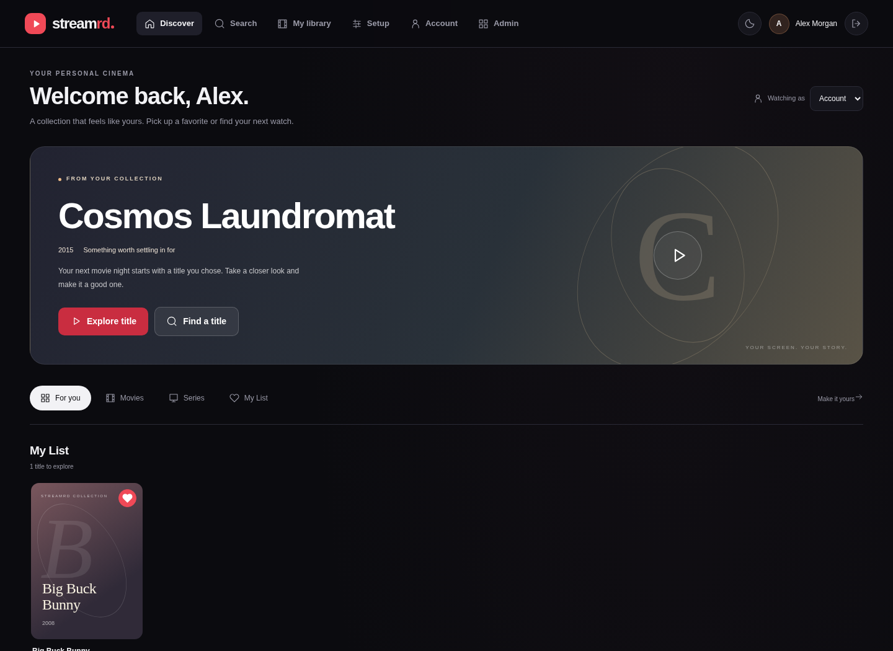

# StreamRD

[Wiki](https://github.com/Installation-04/StreamRD/wiki) · [Releases](https://github.com/Installation-04/StreamRD/releases) · [Roadmap](docs/roadmap.md)

Self-hosted, Netflix-style streaming for your own **debrid** accounts.
One backend and a responsive web app for every screen that has a browser.

```text
   Web (Next.js) ──────┐   HTTPS/HTTP   ┌──────────────────────────────────┐
   Scripts / API ──────┴───────────────▶│ StreamRD backend (Node/TS)       │
                          LAN/proxy/VPN │  REST API · JWT + RBAC · Prisma  │
                                        │  DebridManager ─┬─ Real-Debrid   │
                                        │   (fallback)    ├─ AllDebrid     │
                                        │                 └─ Premiumize.me │
                                        └──────────────────────────────────┘
```

You bring your own debrid subscriptions; StreamRD turns them into a private,
multi-user streaming service with a curated catalog. Use it within the
providers' terms of service and your local law.

## Quick install

With Docker and the Compose plugin installed:

```bash
curl -fsSL https://raw.githubusercontent.com/Installation-04/StreamRD/main/get.sh | bash
```

One container (StreamRD on port 8080, Phosphor on 8081, qBittorrent), laid out like Radarr or Sonarr:
`~/streamrd/config` holds all settings and databases, `~/streamrd/data` holds downloads. **To update:**
`cd ~/streamrd && docker compose pull && docker compose up -d` (or re-run the script); your folders are never
touched. Options go after `bash -s --`, for example `--port 3000 --admin-email you@example.com`; `--help` lists them,
`--import-db` moves an existing install across and `--uninstall` removes the container (folders kept). It does not
install Docker, set up HTTPS or open firewall ports. Read the [script](get.sh) before piping any script to a shell,
and see the [single-container guide](docs/single-container.md).

## Server Sharing — v0.6.0

Invite users, publish named libraries from your imported account collection, and
choose who can watch. Shared viewers use server-managed playback and need no
personal debrid key. Admin → Users controls signup policy, expiring invitations,
account status and signing users out everywhere.

Read the [users and sharing guide](docs/server-sharing.md) for setup and permissions.
Named-library grants do not change the legacy curated catalog's access rules.
Plex Home PINs and parental restrictions remain future work.

v0.8.0 adds media discovery/requests, an all-in-one container, and update/backup/restore
controls in Admin → System ([notes](docs/releases/v0.8.0.md)).

v0.7.0 adds per-viewer watch progress for StreamRD shared libraries: playback resumes
and **Shared libraries** shows a Continue watching row ([notes](docs/releases/v0.7.0.md)).

## Features

- **Multiservice debrid** — Real-Debrid, AllDebrid and Premiumize.me behind
  one pluggable `DebridProvider` interface, with per-user primary provider
  and automatic fallback ordering (per-user or global).
- **Accounts & RBAC** — invitations and signup policies, JWT login, `user`/`admin`
  roles, named-library grants, administrator session revocation, per-user
  debrid keys (stored server-side, returned only as redacted hints),
  Netflix-style viewing profiles (up to 5 per account).
- **My List** — one-click favorite/unfavorite from any title card or the
  detail page; a "My List" row appears on the home page whenever it's non-empty.
- **Continue Watching** — a row of previously-played titles (deduped, most
  recent first) at the top of the home page.
- **Admin dashboard** — users, catalog CRUD with debrid source mappings,
  global provider order/toggles, timeouts & retry caps, access toggles,
  connectivity tests, health stats, structured logs, config export/import.
- **Every screen with a browser** — Netflix-style, responsive web UI
  (dark/light/system theme, i18n-ready).
- **Deploy anywhere** — Dockerized backend + web, Caddy/Nginx reverse-proxy
  examples with HTTPS, works identically over LAN or VPN.
- **Operable** — structured event log (stdout + queryable via admin API),
  playback metrics per provider, `/api/health` for probes, JSON config backup,
  per-IP rate limiting on signup/login.

## Tech stack

| Piece | Stack |
|---|---|
| Backend (`/server`) | Node.js 22, TypeScript, Express, Prisma + SQLite, JWT + bcrypt, Zod, Vitest + Supertest |
| Web (`/web`) | Next.js (App Router), React, TypeScript, cookie session + middleware RBAC gates |
| Infra (`/infra`) | Docker, docker-compose, Caddy & Nginx configs, GitHub Actions CI |

## Quick start

Install Docker Engine with its Compose plugin, then run from the repository root:

```bash
git clone https://github.com/Installation-04/StreamRD.git
cd StreamRD
docker compose up -d --build
```

This starts **one container** containing StreamRD, Phosphor, their APIs/workers and
qBittorrent. Open StreamRD at http://localhost:8080 and Phosphor at
http://localhost:8081. Sign up in each product you want to use; its first account
becomes administrator. The data, downloads and generated secrets persist in one
named volume.

[Single-container setup and local downloads](docs/single-container.md) ·
[Discover, request and track media](docs/media-requests.md).
Existing split deployments and the legacy Debian/Ubuntu installer remain described
in [deployment.md](docs/deployment.md); their volumes are not migrated automatically.

Run pieces directly during development:

```bash
# API on :47821
cd server && npm install && npx prisma generate && npx prisma db push && npm run dev

# Web on :3000
cd web && npm install && npm run dev
```

## Configuration

**Backend** (`server/.env`, see `.env.example`): `PORT`, `DATABASE_URL`,
`JWT_SECRET`, `JWT_EXPIRES_IN`, `API_BASE_URL`/`LAN_URL`/`PUBLIC_URL`,
`CORS_ORIGINS`, `ADMIN_EMAIL`.

**Web**: `NEXT_PUBLIC_API_BASE_URL` — the URL the *browser* uses to reach the
API (LAN IP, proxied domain, or VPN address).

**Mobile & TV**: set the Server URL in each app's settings screen and hit
*Test connection* (probes `/api/health`).

**Debrid providers**: each user pastes their own keys in
Account → Debrid services — Real-Debrid ([apitoken](https://real-debrid.com/apitoken)),
AllDebrid ([apikeys](https://alldebrid.com/apikeys)),
Premiumize ([account](https://www.premiumize.me/account)) — picks a primary
provider, and can test each connection. Details: [docs/providers.md](docs/providers.md).

## Admin guide

The first account on an empty server is admin (or set `ADMIN_EMAIL`). Visit
`/admin` on the web app for users, catalog, server settings, providers,
logs, and config export/import. Full walkthrough:
[docs/admin-guide.md](docs/admin-guide.md).

## Architecture & API

- [docs/architecture.md](docs/architecture.md) — system design, provider
  layer, RBAC, client model
- [docs/api-schema.md](docs/api-schema.md) — every endpoint with
  request/response examples and role requirements

## Deployment

[docs/deployment.md](docs/deployment.md) covers the three reachability modes:

- **LAN** — expose ports, point clients at `http://<lan-ip>:47821`
- **Reverse proxy + HTTPS** — bundled Caddy (automatic Let's Encrypt) or the
  Nginx example in `infra/reverse-proxy/`
- **VPN** — WireGuard/Tailscale; treat tunnel IPs like LAN

## Tests & CI

```bash
cd server && npm test    # RBAC, provider units (mocked HTTP), auth/catalog/playback integration
```

GitHub Actions (`.github/workflows/ci.yml`) typechecks + tests the server,
builds the web app, and smoke-builds both Docker images.

## Contributing

PRs welcome. Keep it small and focused; match the surrounding code style
(TypeScript strict, no default exports in the backend); add or update tests
for behavior changes (`npm test` in `server/` must pass); run `npm run lint`
in the workspace you touched. For a new debrid provider, follow
[docs/providers.md](docs/providers.md#adding-another-provider).

## Related projects

This monorepo also hosts **[Phosphor](phosphor/README.md)** — a separate,
retro terminal-styled debrid app: instead of an admin-curated catalog, you
search your own Torznab indexers (Jackett/Prowlarr) and one-click add
results to Real-Debrid, AllDebrid, Premiumize, or Torbox. Own server, own
clients, own port (61337) — see `phosphor/README.md` to get started.

## License

[MIT](LICENSE).

## Screenshots and external media libraries



See the [screenshot gallery](https://github.com/Installation-04/StreamRD/wiki/Screenshots) for both apps.
Optional mounted-file symlink export for **Plex and Jellyfin** is available under
Admin → Plex / Jellyfin. [Setup and scanning guide](https://github.com/Installation-04/StreamRD/blob/main/docs/plex-jellyfin.md).

## Community development

[Project HQ](https://github.com/Installation-04/StreamRD/wiki/Project-HQ) tracks delivery, acceptance checks, and upcoming work.
The community edition adds guided `/setup`, reviewed mounted-file batches,
and responsive discovery/search workflows. See [contributing](https://github.com/Installation-04/StreamRD/blob/main/CONTRIBUTING.md) to help.

**v0.4.0 Safe Upgrades** adds versioned SQLite migrations, verified snapshots before
existing database changes, and read-only **Admin → System** readiness pages in both
apps. Follow the [upgrade and recovery guide](docs/database-upgrades.md) before
upgrading an existing installation.

## Automatic libraries — v0.5.0

Connect your debrid account during onboarding to import existing torrents into
**My library**, private to your account. Scans follow provider pages, skip duplicate
references, and resolve temporary streams only when you press Play.
[Account scanner and playback guide](docs/account-library.md).

**Admin → Metadata** connects TMDB and OMDb for artwork, descriptions, cast, runtime,
ratings and IMDb IDs. Automatic matching is opt-in; uncertain results can be reviewed
and corrected, and manual edits are protected. Metadata enriches personal imports,
mounted exports and StreamRD catalog titles.
[Metadata setup and matching guide](docs/metadata-automation.md).

User administration and server-managed playback are documented in the
[users and sharing guide](docs/server-sharing.md).
