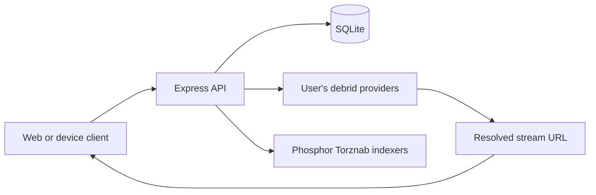

# Architecture and optimization

Each product has an Express/TypeScript API, Prisma/SQLite database, Next.js web
client, and device-client projects. Users authenticate to the API; the API enforces
roles and keeps provider credentials server-side. Clients play resolved stream
URLs directly. The backend does not relay or transcode the video.

StreamRD combines administrator-managed libraries with provider fallback, persistent source
references, scoped file selection, and web profile progress. Its resolver limits
attempts across the full operation and shares one upstream time budget, including
HTTP response bodies. Source references are user-scoped, leased, and reusable
after restart. A crash between a provider side effect and local persistence can
still duplicate an add; those operations cannot be atomic.

Catalog and personal rows use compact cursor pages with supporting indexes. The
legacy endpoints remain for existing clients. Genre discovery still scans JSON
and successful viewing-history aggregation still scans an account's logs; further
schema changes should follow measured production demand.

Phosphor bounds/coalesces search and download-refresh work and uses configuration
snapshots to prevent stale cache writes. Its web queue refreshes visible work with
backoff. These limits are per process; distributed coordination is deferred until
deployments need multiple backend processes.

JWTs pin their algorithm and issuer. Durable logout revocation and account session
versions invalidate old sessions. Unexpected async errors use generic JSON and
request IDs. Provider keys remain plaintext in the database, and browser tokens
remain JavaScript-accessible; encryption, HttpOnly sessions, retention cleanup,
and additional log redaction are planned work.

Read the [optimization plan](https://github.com/Installation-04/StreamRD/blob/main/docs/optimization-plan.md),
[synthetic benchmark](https://github.com/Installation-04/StreamRD/blob/main/docs/catalog-benchmark.md),
and [authentication notes](https://github.com/Installation-04/StreamRD/blob/main/docs/auth-hardening.md)
for evidence and limits. No production performance benchmark or live-provider
playback validation is claimed.
