# Community Edition screenshots — v0.3.0

Sixteen captures from actual production images, with twelve passing browser journeys
and no page errors. All accounts/data are disposable fixtures. Read the
[provenance and validation](https://github.com/Installation-04/StreamRD/blob/v0.3.0/docs/screenshots/v0.3.0/README.md)
for what is real and what is synthetic.

## StreamRD discovery

A real curated catalog, original poster fallbacks, and a saved favorite.

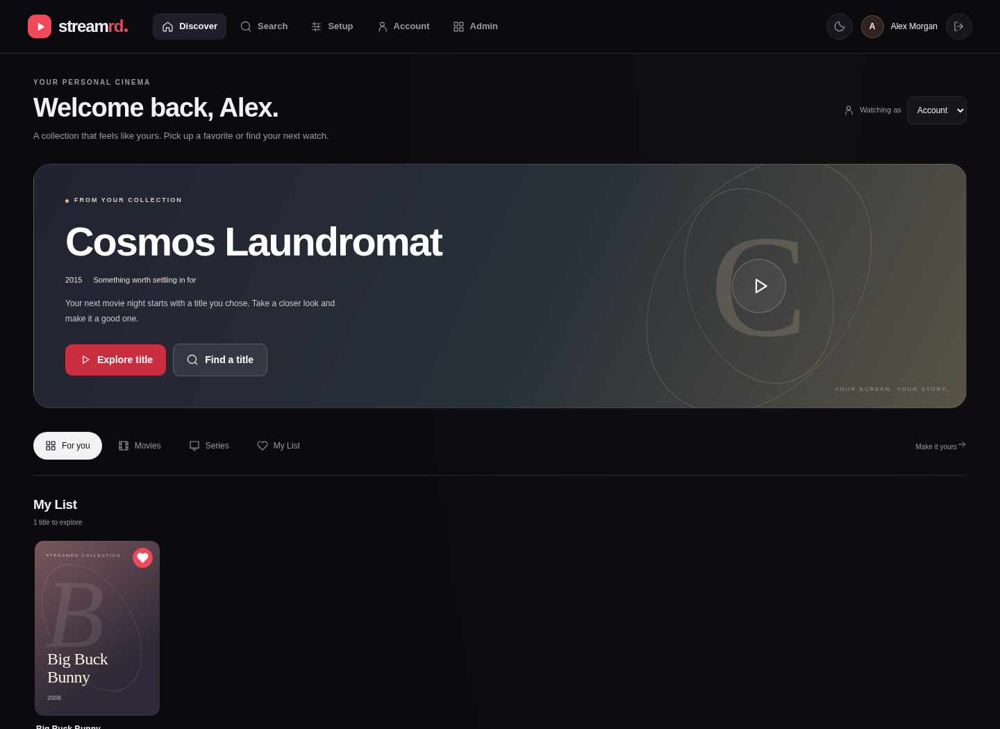

## StreamRD light theme

The same catalog with the actual light-theme control.

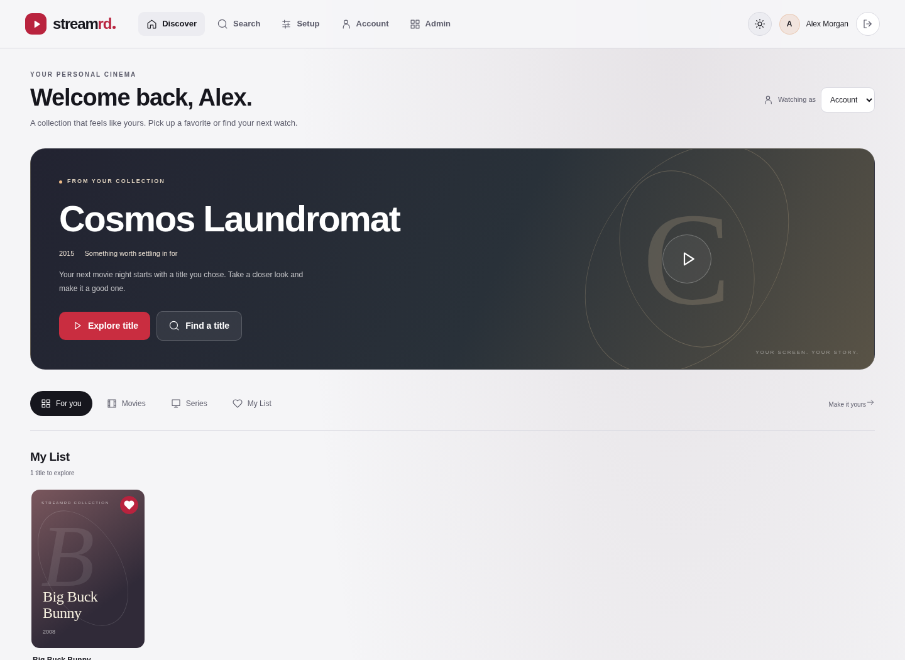

## StreamRD on mobile

390px viewport with responsive navigation and discovery.

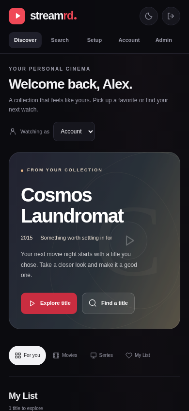

## Guided setup

Local configuration progress, explicit next actions, and optional external libraries.

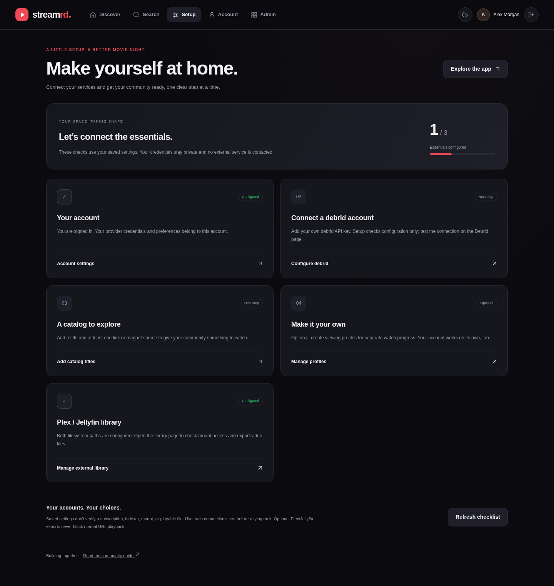

## Setup on mobile

The same checklist in a mobile viewport.

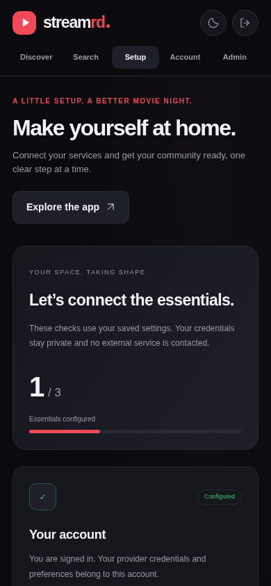

## Reviewed mounted-library exports

Real mounted-file selection and movie/episode batch exports, followed by link repair.

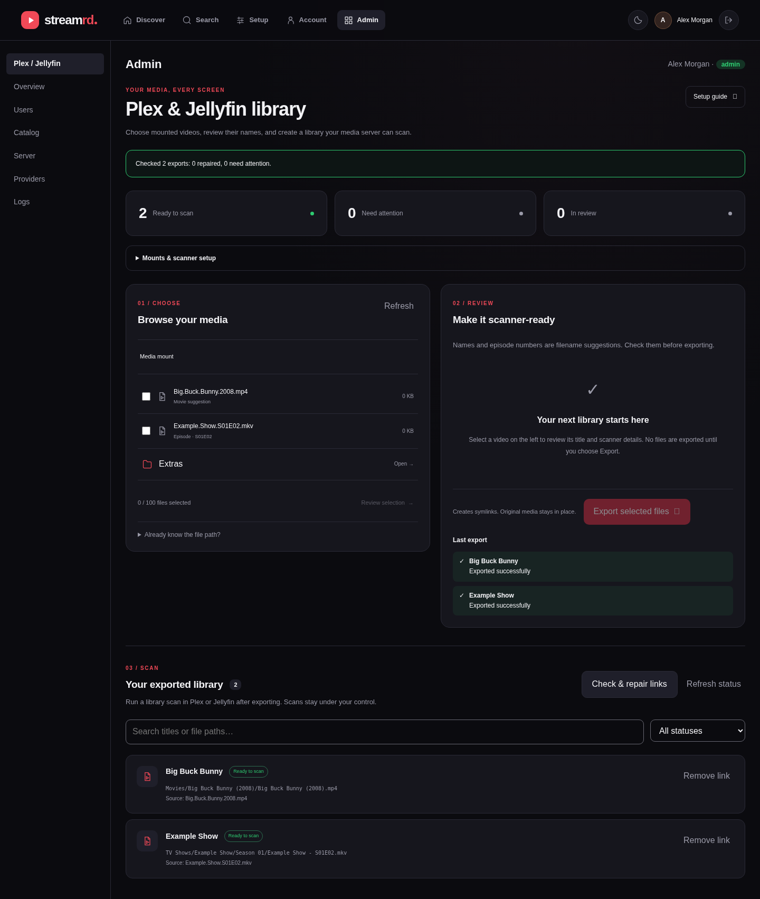

## Library on mobile

Mobile browsing before any demo files are exported.

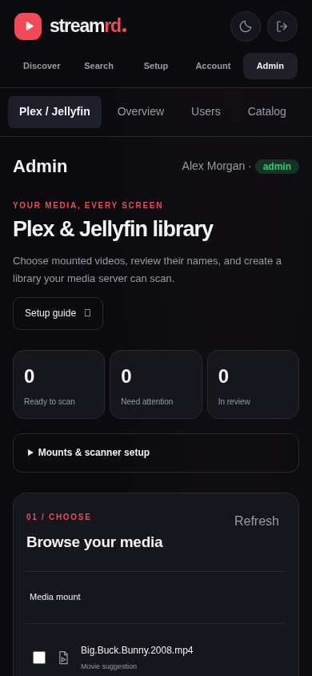

## Phosphor discovery

Local Torznab results, inline saved-search naming, and the green theme.

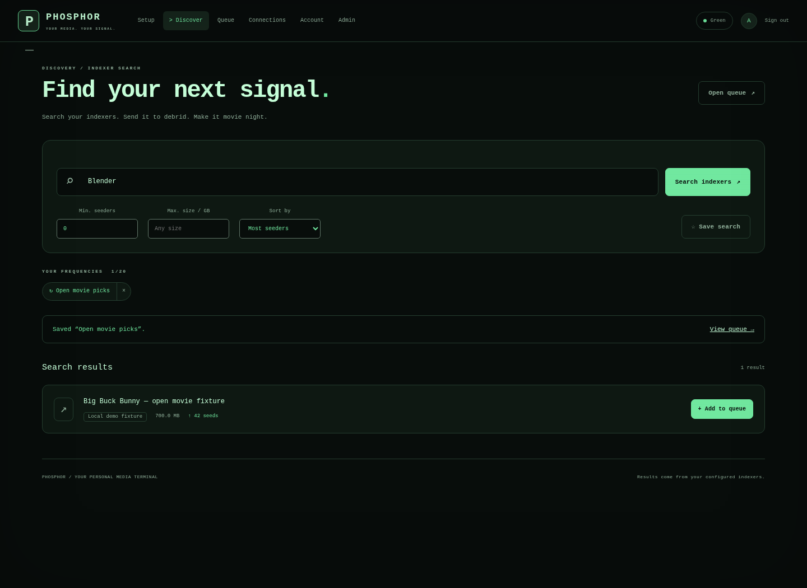

## Phosphor amber theme

Theme control preserves the active search.

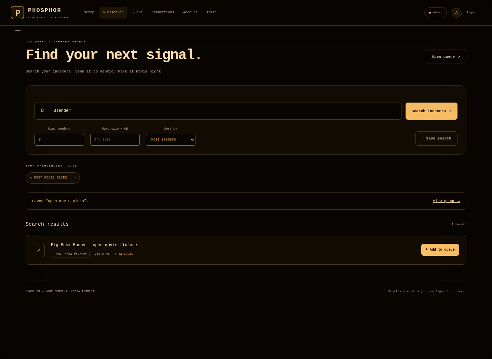

## Phosphor white theme

A third legible phosphor palette.

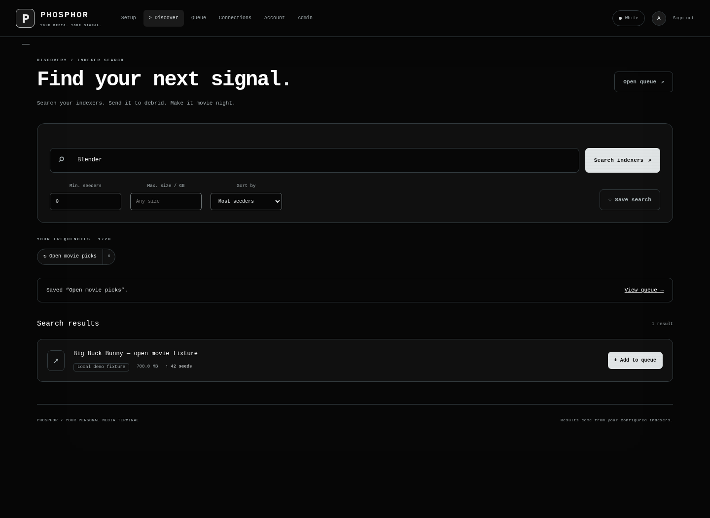

## Phosphor on mobile

Responsive search and filter controls at 390px.

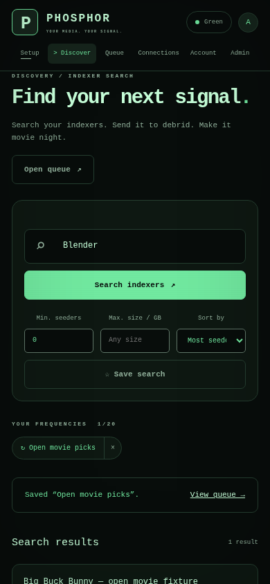

## Phosphor setup

Role-aware connection checklist; configured is explicitly unverified.

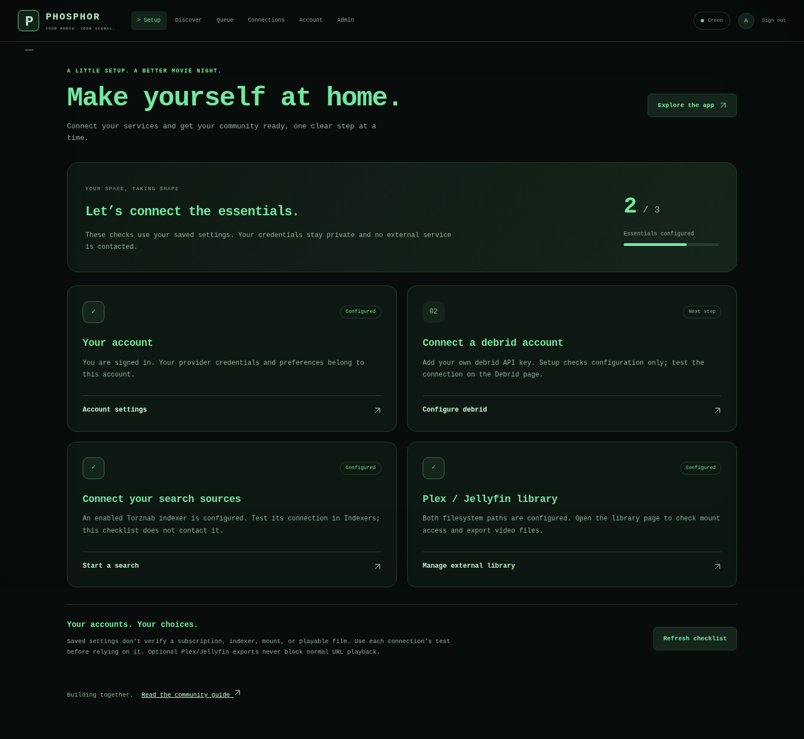

## Phosphor setup on mobile

Mobile setup guidance for a fresh demo installation.

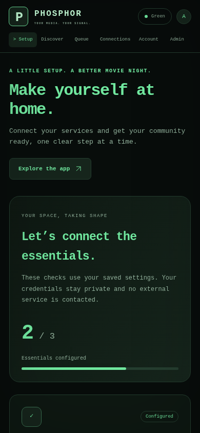

## Phosphor mounted library

The same reviewed movie/episode workflow in the terminal theme.

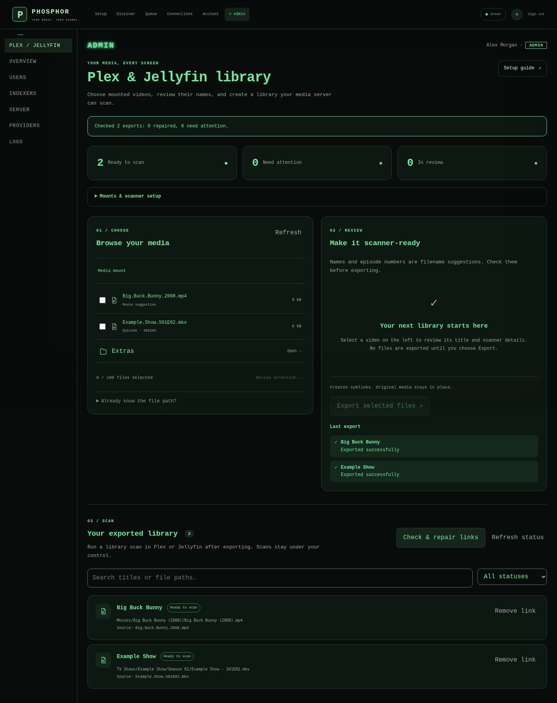

## Phosphor library on mobile

Responsive folder browsing and review panels.

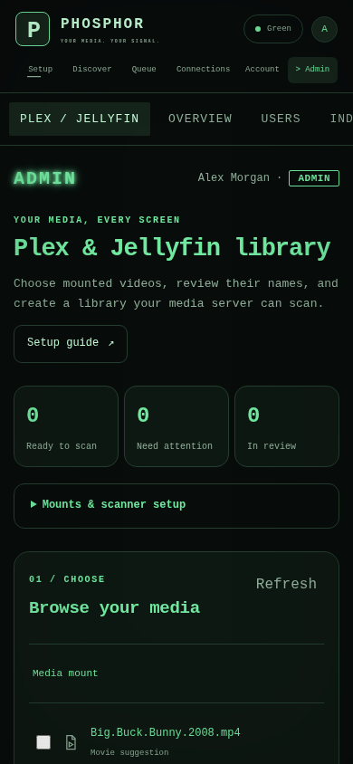

## Phosphor queue

The real empty state; outage recovery is tested separately.

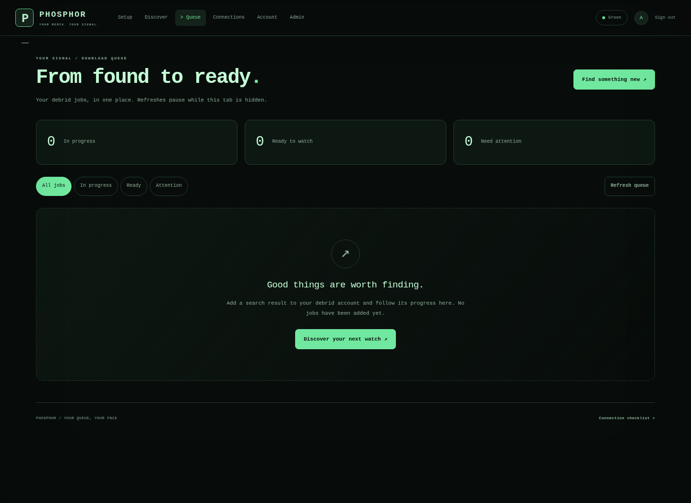

