# Screenshots — v0.2.0

Captured from the actual production web images using disposable demo accounts,
with no browser page errors. Screens are 1440 pixels wide; full pages may be taller.
See [fixture provenance](https://github.com/Installation-04/StreamRD/blob/v0.2.0/docs/screenshots/README.md)
for exactly which data is synthetic. No real debrid credentials or private users
appear in these screenshots.

## StreamRD library

Account/profile selection, Continue Watching, and favorites. Progress is seeded demo data.

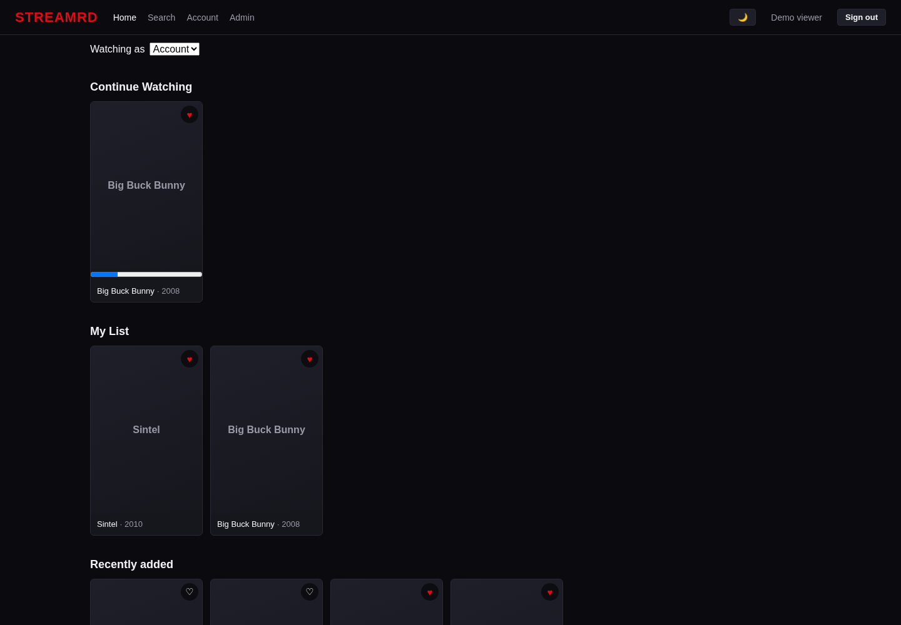

## StreamRD title

Open-movie catalog metadata and My List controls; no poster artwork configured.

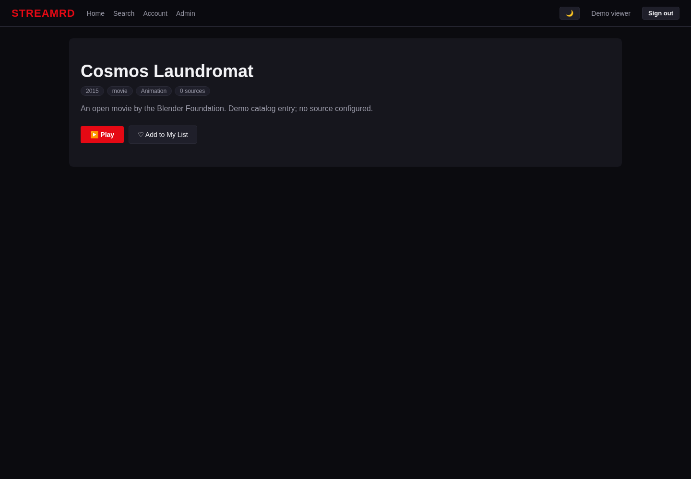

## StreamRD profiles

A disposable Family viewing profile.

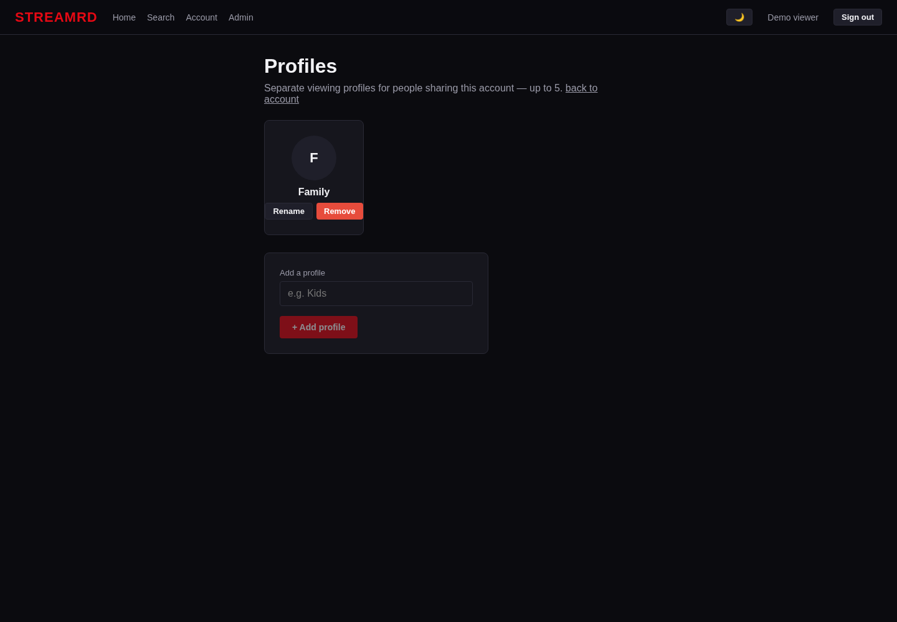

## StreamRD administration

Server settings from a fresh demo deployment.

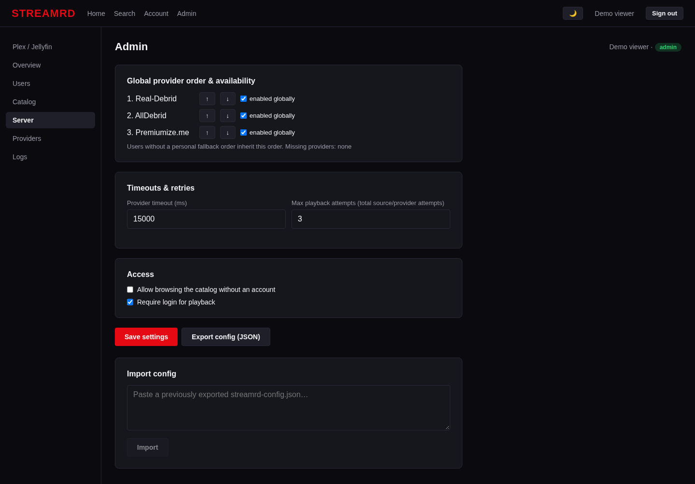

## StreamRD sign in

The production login form.

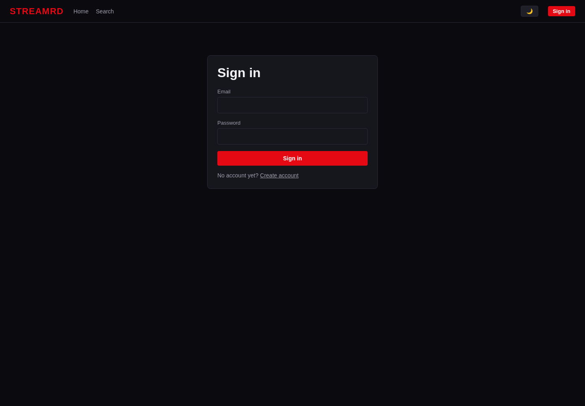

## Phosphor search

Saved search and results returned by a local Torznab fixture, not a live indexer.

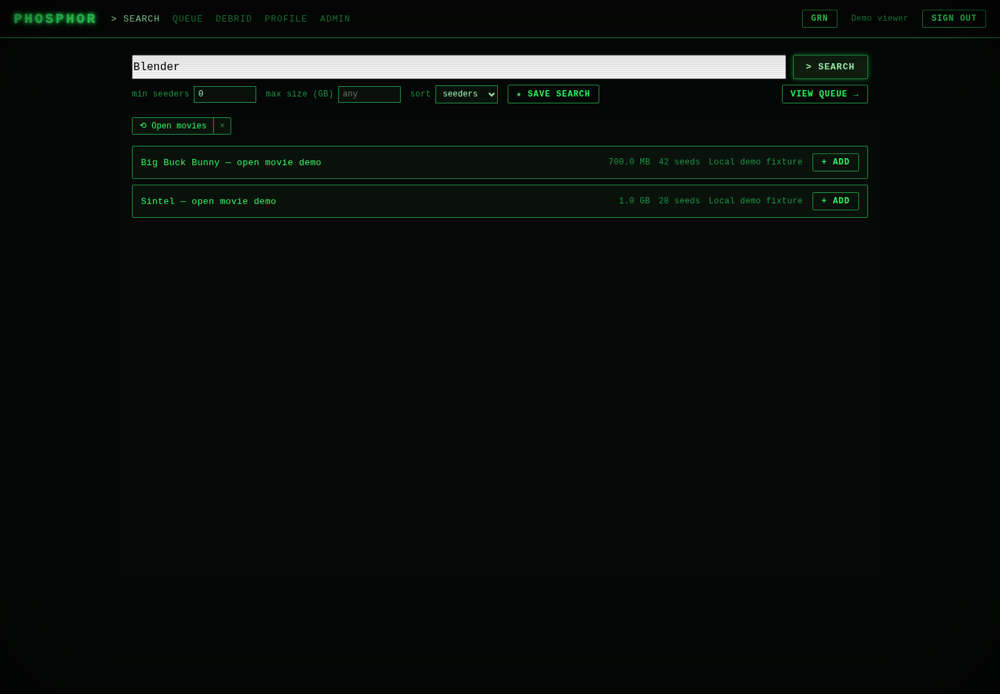

## Phosphor queue

The real first-use empty queue.

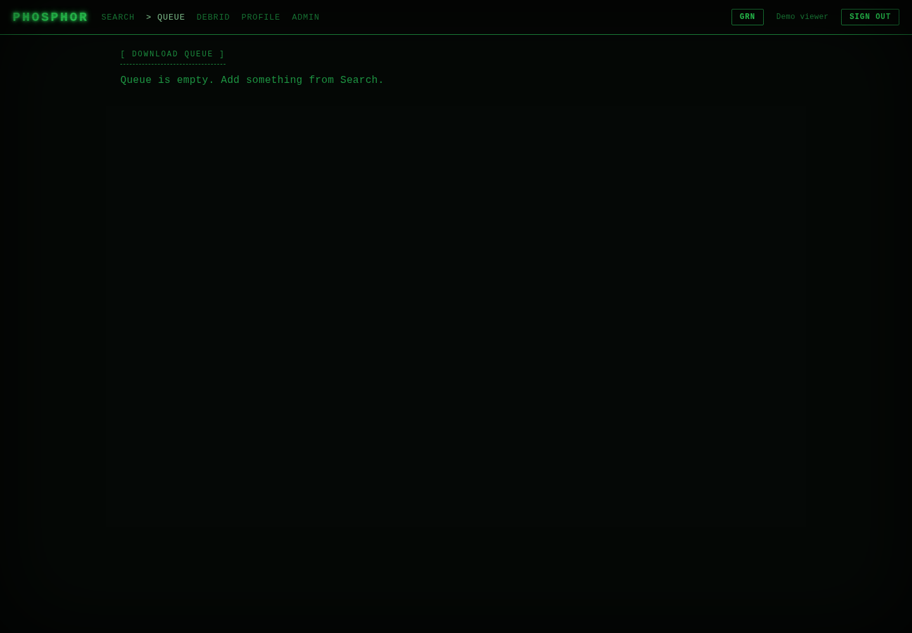

## Phosphor indexers

Local fixture endpoint with a dummy, redacted key.

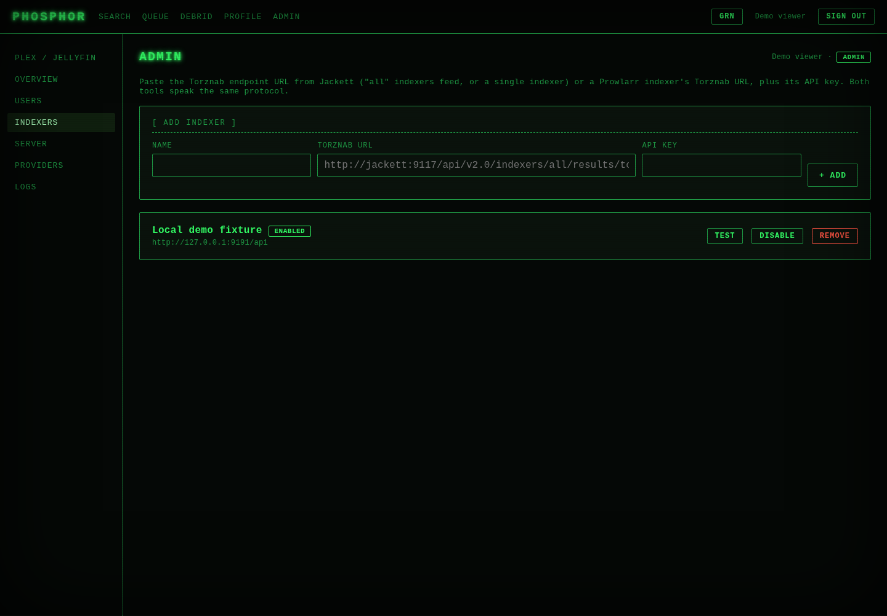

## Phosphor sign in

The production login form.

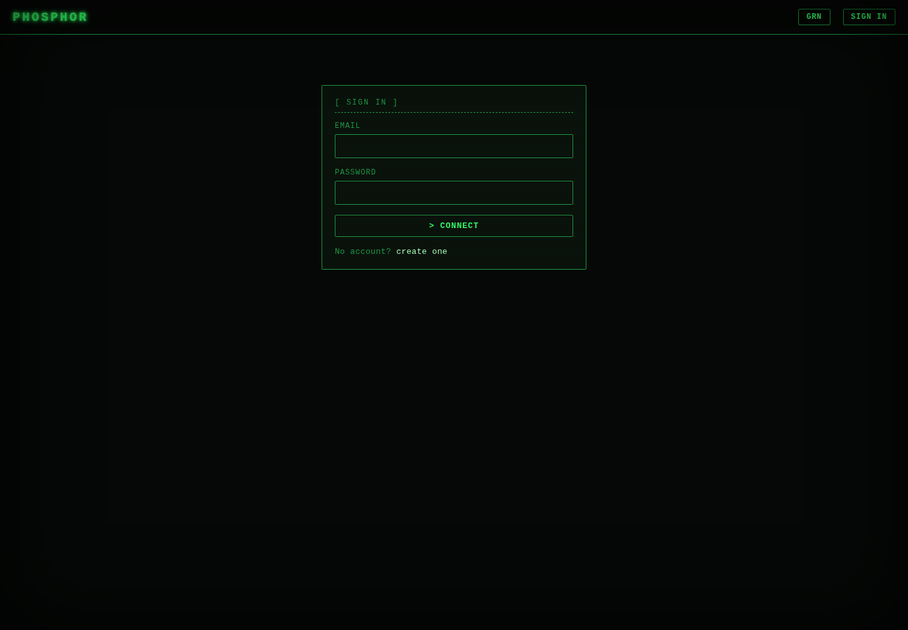

## StreamRD Plex / Jellyfin export

A local mounted-file fixture exported using the real admin form; link repair reports no issues.

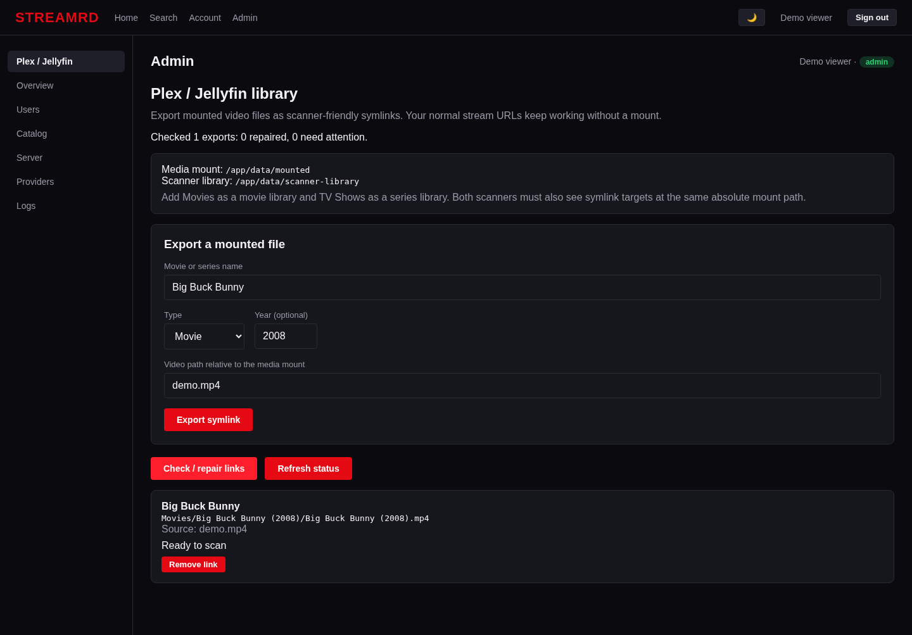

## Phosphor Plex / Jellyfin export

A local mounted-file fixture exported using the real admin form; link repair reports no issues.

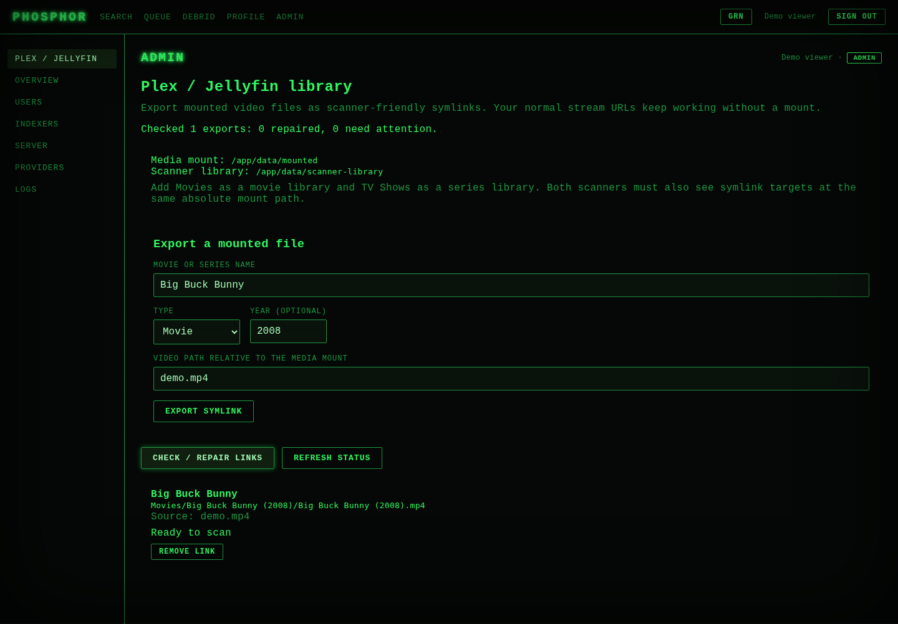

