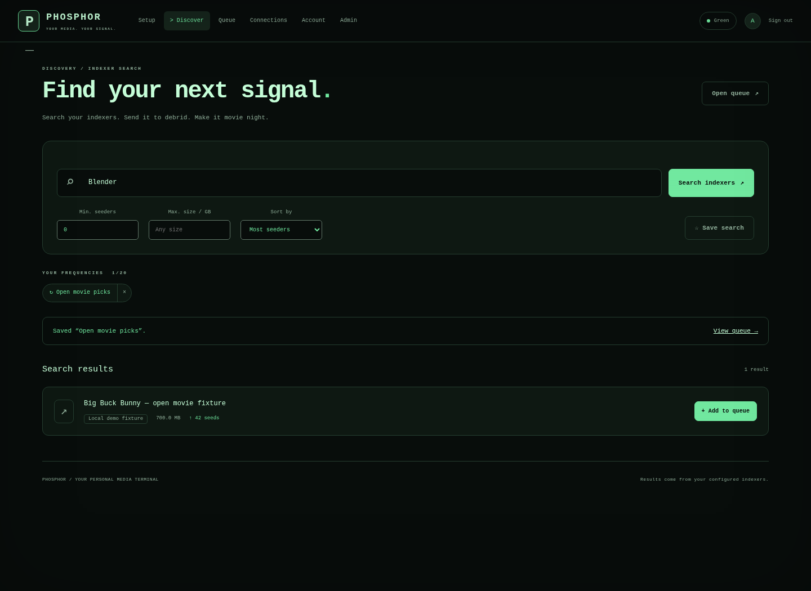

# Phosphor

[Wiki](https://github.com/Installation-04/StreamRD/wiki) · [Releases](https://github.com/Installation-04/StreamRD/releases)

Self-hosted, retro terminal-styled **debrid search-and-stream cockpit**.
No admin-curated catalog — you search your own torrent indexers, one-click
add results to your own debrid account, and stream once resolved.

```text
   Web (Next.js) ──────┐                ┌──────────────────────────────────┐
   Android/Fire TV ────┤   HTTPS/HTTP   │ Phosphor backend (Node/TS)       │
   Apple TV (SwiftUI) ─┼───────────────▶│  REST API · JWT + RBAC · Prisma  │
   Desktop (Tauri) ─────┘  LAN/proxy/VPN │  DebridManager ─┬─ Real-Debrid  │
                                        │                  ├─ AllDebrid    │
                                        │                  ├─ Premiumize   │
                                        │                  └─ Torbox       │
                                        │  Torznab search ──▶ your Jackett/│
                                        │                     Prowlarr      │
                                        └──────────────────────────────────┘
```

You bring your own debrid subscription(s) and your own Jackett/Prowlarr
instance; Phosphor is the glue between "found a torrent" and "watching it."
Use it within the providers' terms of service and your local law.

## Features

- **Search, not a catalog** — queries fan out to every enabled Torznab
  indexer (Jackett or Prowlarr — same protocol, admin just pastes the URL),
  merged/filtered by seeders & size, sorted by seeders/size/date.
- **Multiservice debrid** — Real-Debrid, AllDebrid, Premiumize.me, and
  Torbox behind one pluggable `DebridProvider` interface.
- **One-click add → download queue → play** — add a magnet, poll its
  progress, play the resolved stream the moment it's ready.
- **Saved searches** — save a query plus its filters/sort (up to 20 per
  account) and re-run it in one click from the search page.
- **Accounts & RBAC** — signup/login (JWT, per-IP rate limited), `user`/`admin`
  roles, per-user debrid keys stored server-side (never returned in full,
  only as `****abcd` hints).
- **Admin dashboard** — users, indexers (add/test/enable), global provider
  order & toggles, health stats, structured logs, config export/import.
- **Every screen** — web, Android TV / Fire TV, Apple TV, and a thin Tauri
  desktop wrapper — all retro terminal / CRT themed (scanlines, monospace,
  blinking cursor; an original design, not copied from anywhere), with
  three classic monitor color variants — green, amber, and white phosphor.
- **Deploy anywhere** — Dockerized backend + web, Caddy/Nginx reverse-proxy
  examples with HTTPS, works over LAN, reverse proxy, or VPN. Debian/Ubuntu
  install/uninstall scripts pick free ports automatically.

## Tech stack

| Piece | Stack |
|---|---|
| Backend (`/server`) | Node.js 22, TypeScript, Express, Prisma + SQLite, JWT + bcrypt, Zod, `fast-xml-parser` (Torznab), Vitest + Supertest |
| Web (`/web`) | Next.js (App Router), React, TypeScript |
| TV (`/tv`) | react-native-tvos (Android TV / Fire TV), SwiftUI + AVKit (tvOS) |
| Desktop (`/desktop`) | Tauri — native window embedding the web app |
| Infra (`/infra`) | Docker, docker-compose, Caddy & Nginx configs |

## Quick start

On Debian/Ubuntu, `infra/install.sh` does the rest of this section for you —
installs Docker if needed, picks free ports, and starts the stack:

```bash
git clone https://github.com/installation-04/streamrd.git
cd streamrd/phosphor/infra && sudo ./install.sh   # sudo ./uninstall.sh to remove it
```

Or set it up by hand:

```bash
git clone https://github.com/installation-04/streamrd.git
cd streamrd/phosphor/infra
cp ../server/.env.example .env    # set JWT_SECRET (openssl rand -hex 32)
docker compose up -d --build
```

Open http://localhost:3100, **sign up — the first account becomes admin**.
Then: Admin → Indexers → add a Jackett/Prowlarr Torznab URL (see
[docs/indexers.md](docs/indexers.md)); Account → Debrid → add your
Real-Debrid/AllDebrid/Premiumize/Torbox key. Search, add, play.

Run pieces directly during development:

```bash
# API on :61337
cd server && npm install && npx prisma generate && npx prisma db push && npm run dev

# Web on :3100
cd web && npm install && npm run dev

# TV — see tv/android-tv/README.md and tv/apple-tv/README.md
# Desktop — see desktop/README.md
```

## Configuration

**Backend** (`server/.env`, see `.env.example`): `PORT` (default `61337`),
`DATABASE_URL`, `JWT_SECRET`, `JWT_EXPIRES_IN`,
`API_BASE_URL`/`LAN_URL`/`PUBLIC_URL`, `CORS_ORIGINS`, `ADMIN_EMAIL`.

**Web**: `NEXT_PUBLIC_API_BASE_URL` — the URL the *browser* uses to reach
the API.

**TV/Desktop**: set the server (TV) or app (desktop) URL in settings and
test the connection.

**Indexers & debrid providers**: see [docs/indexers.md](docs/indexers.md)
and [docs/providers.md](docs/providers.md).

## Admin guide

[docs/admin-guide.md](docs/admin-guide.md) — becoming admin, the dashboard
tour, and common workflows (bootstrapping, handling failed downloads/flaky
indexers, backups).

## Architecture & API

- [docs/architecture.md](docs/architecture.md)
- [docs/api-schema.md](docs/api-schema.md)

## Deployment

[docs/deployment.md](docs/deployment.md) — LAN, reverse proxy + HTTPS
(Caddy bundled, Nginx example), VPN.

## Tests & CI

```bash
cd server && npm test    # RBAC, provider units incl. Torbox (mocked HTTP), Torznab XML parsing, search+downloads integration
```

`.github/workflows/phosphor-ci.yml` typechecks + tests the server, builds
the web app, and smoke-builds both Docker images — scoped to changes under
`phosphor/` so it doesn't run alongside the sibling StreamRD project's CI.

## Contributing

PRs welcome. Keep it small and focused; match the surrounding code style;
add or update tests for behavior changes (`npm test` in `server/` must
pass). For a new debrid provider, follow
[docs/providers.md](docs/providers.md#adding-another-provider).

## License

MIT — see the repository root [LICENSE](../LICENSE).

## Screenshots and external media libraries



See the [screenshot gallery](https://github.com/Installation-04/StreamRD/wiki/Screenshots) for both apps.
Optional mounted-file symlink export for **Plex and Jellyfin** is available under
Admin → Plex / Jellyfin. [Setup and scanning guide](https://github.com/Installation-04/StreamRD/blob/main/docs/plex-jellyfin.md).

## Community development

[Project HQ](https://github.com/Installation-04/StreamRD/wiki/Project-HQ) tracks delivery, acceptance checks, and upcoming work.
The community edition adds guided `/setup`, reviewed mounted-file batches,
and responsive discovery/search workflows. See [contributing](https://github.com/Installation-04/StreamRD/blob/main/CONTRIBUTING.md) to help.
